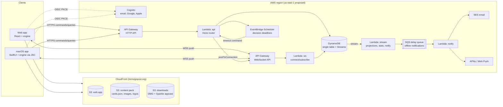
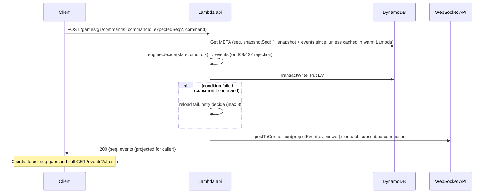

# Torn Signpost — Architecture & Design

Status: **APPROVED** (Phase 2 signed off 2026-10-29)
Last updated: 2026-10-29
Implements: [`01-requirements.md`](01-requirements.md) (requirement IDs referenced inline)

## 1. Summary

- One **pure TypeScript game engine** (`packages/engine`) is the single source of game logic. It
  runs in AWS Lambda (authoritative), in the browser, and in the Mac app through JavaScriptCore
  (to compute available actions, validate commands and predict results immediately).
- **Every game change is a command** (from a drag, the action toolbar, a context menu or the
  console). The engine turns each command into **events**, and the server appends them to a
  per-game **event log** in DynamoDB using optimistic concurrency.
- Each viewer gets their own **redacted view** of those events, pushed over **API Gateway WebSockets**.
  Commands are sent over HTTPS.
- **Pending decisions** (block windows, impulses, confirmations) are part of the game state. The game
  waits for whoever owns the current decision. Real-time and play-by-post games are the same thing;
  only the deadlines differ (TEMPO-03).
- Everything runs **serverless and pay-per-use** in one AWS region, at an estimated
  **US$10–20/month** at hobby scale (NFR-01, §12).
- **World of Darkness content** (card data, images, logos) lives in a separately deployed
  **content pack** and is never in the open-source repository (LEGAL-08).

## 2. System overview



## 3. Architecture decisions

| ID | Decision | Rationale | Alternatives considered |
|---|---|---|---|
| AD-01 | **Event-sourced game state**: per-game append-only event log, plus periodic snapshots | Matches NFR-04, gives replay (GAME-17), the log (GAME-12), auditability and per-viewer redaction | Store mutable state only. Loses history and makes redaction of the log hard |
| AD-02 | **Engine is pure and deterministic**: `decide(state, command, ctx) → events`, `evolve(state, event) → state`. Randomness and time are injected | Same code runs on server and clients; replay is exact; easy to test | Server-only logic. Breaks offline validation, optimistic UI and the Mac bridge |
| AD-03 | **Commands over HTTPS, push over WebSocket** | HTTP gives idempotent, retryable commands with simple auth that work while the socket is down. WebSocket is used only for low-latency fan-out and presence | Commands over the socket (slightly lower latency but harder retries/auth); polling only (misses TEMPO-02) |
| AD-04 | **API Gateway WebSocket** for realtime (not AppSync Events) | `$connect`/`$disconnect` give presence (TEMPO-06) for free; each connection gets its own redacted payload; mature CDK support | AppSync Events: cheaper connection-minutes, but channel-level fan-out doesn't suit per-viewer redaction and has no disconnect hook |
| AD-05 | **DynamoDB single table (on-demand) with Streams** | Scale-to-zero, single-digit-ms reads and writes, conditional writes for per-game serialisation, Streams for side effects | Aurora Serverless v2 (minimum cost breaks NFR-01); Postgres on RDS (always-on) |
| AD-06 | **Lambda on Node.js 24 LTS, arm64, esbuild-bundled, no VPC**, with a few "lambdaliths" using the Hono router | Fast cold starts (<1 s) and no NAT cost. Hono runs the same in Lambda and in a local Node server | One function per route (more cold starts, more IaC); containers (always-on cost) |
| AD-07 | **Card database delivered as static, versioned JSON** from the content CDN, searched client-side | ~4k cards fit in about 1 MB gzipped; search is instant and works offline (PLAT-02) at zero server cost | Server search endpoint/OpenSearch (cost, latency) |
| AD-08 | **Content pack is a separate stack, bucket and distribution** (`content.tornsignpost.org`) | LEGAL-08: WoD IP can be withdrawn with no code change; the repository contains no assets | Bundling assets in the apps (can't withdraw them; puts IP in the open-source repository) |
| AD-09 | **Cognito user pool** with Managed Login, Google and Apple IdPs, OAuth 2 code + PKCE | Free under 10k MAU, standard OIDC for both web and Swift, no custom auth code | Auth0/Clerk (cost, third party); custom (risk) |
| AD-10 | **Web table rendered with DOM + CSS transforms**, not canvas/WebGL | Accessibility (NFR-07: focusable cards, screen readers), native pointer/touch events, layout animations. A few hundred elements is well within DOM limits | PixiJS/canvas (fast, but accessibility and text rendering must be rebuilt) |
| AD-11 | **SwiftUI client embeds the engine as a JS bundle in JavaScriptCore** | One rules implementation (D4); Swift handles only rendering, gestures, platform integration and I/O | Port the engine to Swift (two implementations drift) |
| AD-12 | **Shared contracts**: Zod schemas in `packages/protocol` generate OpenAPI and JSON Schema, which in turn generate Swift types | Web and Mac can't drift from the API; one place to version the protocol | Hand-written Swift models |
| AD-13 | **Monorepo**: pnpm workspaces + Turborepo; Swift package and Xcode project live in the same repo | Atomic changes across engine, API and clients; one CI | Multiple repos |
| AD-14 | **Infrastructure as code with AWS CDK (TypeScript)**; a **single AWS account** running one live-beta environment (proof of concept); GitHub Actions with OIDC | Same language as everything else (D3); no long-lived keys | Terraform/SST (fine, but adds a second language/tool) |
| AD-15 | **Single AWS region: us-east-1** (confirmed) | Best average latency across the VTES player base (Americas, Europe, Oceania); every service available; CloudFront certificates must live there anyway | eu-west-1 (better for Europe, worse for the Americas and Oceania); multi-region (cost and complexity) |

## 4. The game engine (`packages/engine`)

Pure TypeScript with no I/O, no Node or DOM APIs and no WoD text, so it runs unchanged in Lambda,
browsers and JavaScriptCore. Card attributes come from an injected `CardCatalog`.

### 4.1 Core model

The game is modelled around **seats** (Methuselahs), not users. Cards, zones, pool and VP belong
to a seat, and a user *occupies* a seat. This is what makes player replacement (§4.1.2) a
one-event change.

```ts
type GameState = {
  id: GameId; engineVersion: string; format: 'standard' | 'v5' | 'duel';
  seq: number;                       // last applied event
  seats: Seat[];                     // physical seating, clockwise; never reordered (§4.1.1)
  turnDirection: 'toPrey' | 'toPredator';  // normally 'toPrey'; some cards reverse it
  cards: Record<InstanceId, CardInstance>;
  zones: Record<ZoneId, InstanceId[]>;   // per-seat crypt, library, hand, uncontrolled,
                                         // ready, torpor, ashHeap, removed, research (GAME-02)
  turn: { number: number; seat: SeatId; phase: Phase };  // GAME-05
  flow: FlowFrame[];                 // stack: action → block loop → combat → … (GAME-06/07)
  windows: Window[];                 // open impulse/polling windows (§4.4)
  pending: Decision[];               // who the game is waiting on (TEMPO-03)
  clock: Clock;                      // table timer (TEMPO-05)
  settings: GameSettings;            // deadlines, permissions
  status: 'setup' | 'active' | 'finished';
};

type Seat = {
  id: SeatId;                        // stable for the whole game
  occupant: UserId;                  // current player (changes on replacement)
  occupants: { user: UserId; from: Seq; to?: Seq; reason: 'start' | 'replaced' }[];
  pool: number; vp: number; hasEdge: boolean;            // GAME-04
  ousted?: { atSeq: Seq; by?: SeatId }; withdrawn?: boolean;
  transfersLeft?: number;
};

type CardInstance = {
  id: InstanceId; cardId?: CardId;   // cardId missing in views where the card is hidden
  owner: SeatId; controller: SeatId;
  locked: boolean; faceDown: boolean; contested: boolean;   // GAME-03
  counters: Partial<Record<'blood' | 'life' | 'generic', number>>;
  attachedTo?: InstanceId; notes?: string;
};
```

M1 implements seats, cards, zones, turn and status. `flow`, `windows`, `pending` and `clock` are
added with the structured flow in M5. Attached cards move with their host between ready and
torpor; when the host goes anywhere else, they stay where they are and are detached.

#### 4.1.1 Seating, predator/prey and turn direction (GAME-01, GAME-20)

- `seats` is the **physical seating in clockwise order** and never changes during a game. Your
  **prey sits to your left** (the next seat clockwise) and your **predator to your right** (the
  previous seat).
- Predator and prey are **derived, never stored**: `prey(s)` is the next *non-ousted* seat
  clockwise, and `predator(s)` the next non-ousted seat anticlockwise. When a Methuselah is ousted
  (or withdraws), every relationship is recalculated from the physical seating automatically, so
  the ousted seat's predator now hunts the ousted seat's prey.
- **Turn order is global and separate from predator/prey.** At the end of a turn, play normally
  passes to the current player's prey (`turnDirection: 'toPrey'`). Cards that reverse play order
  issue `SetTurnDirection`. The **only** effect of a reversal is which seat takes the next turn
  (`nextTurnSeat` walks to the predator instead). Predator/prey relationships, bleed targets, VP
  awards and impulse order always follow the physical seating.
- **Ousting during your own turn** (GAME-21): the ousted seat's turn ends. It is removed from every
  open window and receives no further decisions (they can no longer do anything), and the
  predator's VP and 6 pool are awarded as normal. The effect that caused the oust finishes
  resolving first, and while the current action finishes, references to the acting seat's
  relationships (e.g. "your prey") are read as they were before the oust. Any combat involving the ousted
  seat ends at once, the current action ends, and play passes via `nextTurnSeat` from the ousted
  seat's position (DQ9, following zero-vtes's rulings).
- `SetTurnDirection` is also available as a primitive (toolbar/console) for cards the engine
  doesn't automate yet.
- All seat-relative helpers (`prey`, `predator`, `nextTurnSeat`, `crossTable`, window orders) live
  in one module, so oust and reversal rules are applied in exactly one place.

#### 4.1.2 Player replacement (GAME-19)

- An **admin** (not necessarily a judge) can replace the occupant of a seat in a **non-tournament
  game** with a willing player: `ReplacePlayer{seat, newUser}` → `PlayerReplaced` event.
- Because everything is owned by the seat, the new player immediately takes over **all cards owned
  by the seat** (wherever they are, including cards controlled by others), plus its hand, library,
  crypt, pool, VP and Edge. Nothing is copied or re-keyed.
- Projection is computed per seat and the viewer → seat mapping uses the *current* occupant, so the
  new player sees the seat's hidden information from that event onwards and the previous player
  loses access.
- Pending decisions and deadlines owned by the seat transfer to the new occupant. Any open
  deadline judge call is resolved automatically.
- **Discovery**: an admin can mark a stalled game's seat as "replacement wanted", which lists it in
  the lobby for volunteers. The admin confirms the volunteer.
- **Stats** (DQ8): the result is credited to the occupant at game end. Earlier occupants get a
  "replaced" record (game played, no GW/VP).
- The command is rejected for tournament games (TOURN rules govern those; organisers/judges
  withdraw players instead).

### 4.2 Commands, events and the shared command vocabulary

```ts
decide(state: GameState, cmd: Command, ctx: { actor: Actor; now: Instant; rng: Rng; catalog: CardCatalog })
  : Result<GameEvent[], Rejection>
evolve(state: GameState, ev: GameEvent): GameState
```

Every input method produces the same `Command` objects (D10):

| Layer | Examples | Produced by |
|---|---|---|
| **Primitives** (always available; GAME-10 permissions) | `MoveCard`, `SetLocked`, `AdjustCounter`, `TransferBlood`, `Draw`, `Shuffle`, `Flip`, `Attach`, `AdjustPool`, `Reveal`, `SetTurnDirection` | Drag-and-drop, context menu, console |
| **Structured flow** | `AdvancePhase`, `DeclareAction{kind: bleed\|hunt\|political\|equip\|…}`, `Block`, `DeclineBlock`, `PlayCard`, `Pass`, `Wait`, `ChooseRange`, `Strike`, `CastVotes`, `Confirm`/`Cancel` | Action toolbar and prompts |
| **Judge** | `CallJudge` (any seated player), `ResolveJudgeCall`, `JudgeReveal`, `JudgeCorrect` | Players, judges |
| **Admin** | `ReplacePlayer` (non-tournament games only, §4.1.2) | Admins |
| **System** | `DeadlineExpired`, `PlayerPresent`/`PlayerAbsent`, `Oust`, `EndGame` | Scheduler, WebSocket presence, the engine itself |

**Confirmation instead of undo (GAME-11).** A command that reveals information or affects another
player is first *staged* locally (the client previews it with the engine) and only sent after the
player confirms. Nothing is staged on the server, so there's nothing to undo; corrections are new
commands with their own log entries.

**Console (GAME-13).** `packages/engine/console` parses console text (for example `move "Arika" torpor`,
`blood +2 arika`, `pool -1`) into the same commands. It provides completion data (card names,
targets) for both web and Mac. Scenario tests are written in console syntax (§11). The syntax
reference is [console.md](console.md).

### 4.3 Available actions — what drives the toolbar (UX-03)

```ts
availableActions(view: PlayerView, viewer: PlayerId, catalog): ActionOffer[]
// ActionOffer = { kind: 'bleed', label: i18nKey, steps: SelectionStep[] }
// SelectionStep = { pick: 'minion' | 'card' | 'target' | 'amount', candidates: InstanceId[] | Range, optional? }
```

The toolbar renders the `ActionOffer`s. Choosing one walks through its `SelectionStep`s,
highlighting only the candidates, and the finished selection becomes a `Command`. Because this runs
on the **redacted view**, it works on clients (they know their own hand) and on the server.
Drag-and-drop asks the same function for valid drop targets (UX-02). Context menus (UX-04) list
the offers that apply to the selected card.

### 4.4 Decisions, impulses and "halt when waiting" (TEMPO-01/03/04)

- **Decision requests**: the engine runs every deterministic step itself and stops only when a
  seat must choose. That choice is recorded in `pending: Decision[]` as `{ id, seat, kind, window?,
  options, deadline? }`. This is the "decision request" design that zero-vtes uses.
- **Windows: two primitives**, adopted from
  [zero-vtes](https://github.com/lionel-panhaleux/zero-vtes) (`crates/engine/src/window.rs`, MIT;
  credited in `NOTICE`), which is more developed than JOL's `ImpulseEngine`. Both share a
  `Rotation { order: SeatId[], cursor, quiet }` core.

  | Primitive | Used for | Rules |
  |---|---|---|
  | **Ordered window** (impulse/sequencing) | as-announced, block loop, as-played, combat steps, after-combat, after-resolution, end-of-phase rotation | The impulse rotates through `order`. A **play returns the impulse to the acting Methuselah and voids all prior passes**. The window **closes when every seat passes consecutively** |
  | **Polling window** (commitment) | referendum votes and ballots | No priority holder and no reset. Each offer is an **irrevocable commitment** or a **pass without forfeit**. Closes on a full rotation of consecutive passes, so every commitment reopens a response opportunity for everyone |

  - **Order**: acting Methuselah first. For a **directed** effect, the target seat next. For an
    **undirected** effect, prey then predator. Then the remaining seats clockwise from the acting
    seat. Impulse order always follows the **physical seating**; a reversed turn direction doesn't
    affect it (§4.1.1).
  - **Continuation** (`after(order, seat)`): resume a window after a given seat with the passes so
    far counted. Used by the block loop, where the attempting Methuselah's pass is its decline.
  - **Oust mid-window** (`remove(seat)`): the seat leaves the rotation, keeping the impulse and the
    passes so far.
  - The two primitives **interleave** during referendums: votes are polled while card plays stay ordered.
  - **Each of the active Methuselah's phases ends with a rotation** over the other seats (out-of-turn
    plays), then the phase advances.
  - **Block loop**: one ordered window. A pass with no block attempt pending is a final decline,
    reopened only if the action's target changes.
- **Window elision vs. structured tabletop**: zero-vtes's engine knows every card, so it can skip
  windows it can prove are empty. We can't (card effects are mostly not scripted), so we skip a
  window only when it's *structurally* empty (e.g. no cards in hand and no in-play cards that can
  be used). Otherwise opt-in auto-pass with a random delay applies (DQ2). A player can press
  **Wait** in a window, which cancels their pending auto-pass for that window (the equivalent of saying "hold on" at a physical table).
- The game never "switches mode". It simply waits on `pending`. If the owner is connected, they
  respond in seconds. If not, they're notified and the game waits (TEMPO-03).
- **Two clocks, chosen by presence** (TEMPO-04/05):

  | Situation | Clock | Behaviour |
  |---|---|---|
  | **Real-time**: every seated player is connected | **Table timer** (default 2 h) | No per-decision deadlines. Slow play is handled by a **judge call** (GAME-18), which pauses the table timer until the judge resolves it |
  | **Async**: at least one seated player is absent | **Response deadline** per decision owned by an absent player (default 24 h, reminder at 12 h) | The deadline starts when the decision is pending *and* its owner is absent. If the owner reconnects, the deadline is cleared |

- `GameState.clock = { limitMs, elapsedMs, runningSince?, pausedBy?: JudgeCallId }`. The engine
  derives "running" from presence events (`PlayerPresent`/`PlayerAbsent`, emitted by the server
  from WebSocket connect/disconnect, debounced ~30 s so a network blip doesn't flip the mode) and
  from open judge calls.
- **Deadline policy resolution** (most specific wins): tournament date-range override → tournament
  default → game setting → platform default (24 h). Organisers can configure holiday ranges as
  "extend deadlines to N h" or "pause deadlines until date".
- **Expiry mechanics**: a one-off EventBridge Scheduler schedule (`ActionAfterCompletion: DELETE`)
  fires the reminder, then `DeadlineExpired`, for each async deadline. It's idempotent: if the
  decision is already resolved or the owner has returned, it does nothing.
- **Expiry never decides for the player** (DQ6): `DeadlineExpired` opens a `JudgeCall{reason:
  deadline}` routed to the tournament's judges, or the global judge pool for casual games. The judge
  rules (e.g. apply the default pass, extend the deadline, or withdraw/remove the player) with
  `JudgeCorrect`/`ResolveJudgeCall`. The absent player can still respond until the judge rules.
- The table timer is **paused while the game is async** (DQ7). Async tournament games are bounded
  by the round end date set by the organiser.
- **Judge calls**: `CallJudge{reason}` opens a `JudgeCall` (pausing the clock) and notifies the
  tournament's judges, or the global judge pool for casual games. `ResolveJudgeCall{ruling}` resumes
  the clock. Judges can apply rulings with `JudgeCorrect` (audited).

### 4.5 Hidden information & per-viewer projection (GAME-15/16, GAME-03 face-down)

```ts
project(state: GameState, viewer: Viewer): PlayerView          // Viewer = player | judge | spectator
projectEvent(before: GameState, after: GameState, ev: GameEvent, viewer: Viewer): GameEvent
```

- Each event has a **public** part and optional **private** parts keyed by player (for example
  `Draw` is public as "Ankha drew 1 card", but private to Ankha with the card ID).
- Hidden cards (library, hand, crypt, uncontrolled, face-down) are sent without `cardId`.
  Visibility: crypt and library are hidden from everyone, including their owner. Hand and
  uncontrolled region are visible only to their seat. Face-down cards are visible only to their
  owner.
- An event names a card only if the viewer could see it before or after the event. A shuffle's
  old-to-new ID mapping goes only to viewers who can see the zone.
- A view is the same `GameState` shape with `cardId` missing on hidden cards, so clients follow the
  game with the same `evolve`, re-projecting after each event:
  `project(evolve(view, projectEvent(…)), viewer)` always equals `project(evolve(state, ev), viewer)`.
  The property tests check this.
- A card entering a hidden zone loses its in-play state (lock, counters, attachments, contested).
  Shuffles apply to crypt, library and hand only.
- **Instance ID re-keying**: when a card enters a hidden zone, turns face down or is shuffled, it gets a fresh
  random `InstanceId`. Otherwise a card that was revealed could be tracked through a shuffle.
- **Shuffles** use `crypto.randomInt` Fisher–Yates on the server. The resulting order is
  recorded in a private event payload, so replay is deterministic.
- **Judges** see public information plus anything revealed with `JudgeReveal`, which writes an
  audit event visible to all players (GAME-03).
- **Spectators and guests** get the public projection only and are read-only (GAME-16).
- A property-based test suite asserts that for any random event sequence, `project(…, p)`
  contains no hidden identity of another player (§11).

### 4.6 Versioning

- Every game records the `engineVersion` it started with. Events are versioned, and there are
  upcasters for old event shapes, so games in progress survive deploys.
- Clients send their engine version. On a **major** mismatch the server answers `426 Upgrade Required`.
  On a **minor** mismatch the client falls back to `GET /games/{id}/actions` (offers computed on
  the server), so an older Mac build keeps working until it's updated.

## 5. Backend

### 5.1 API surface (HTTP API; public routes allow guests)

| Area | Routes (abridged) | Auth |
|---|---|---|
| Games | `POST /games` · `GET /games?status=open\|active\|mine` · `GET /games/{id}` (projected view) · `POST /games/{id}/join` · `POST /games/{id}/commands` · `GET /games/{id}/events?after=` · `GET /games/{id}/actions` | View/list public games as a guest; everything else needs a player |
| Chat | `POST /chat/{channel}` · `GET /chat/{channel}?before=` | Players (guests have no chat) |
| Decks | `GET/POST/PUT/DELETE /decks` · `GET /decks/public?format=&clan=` · `POST /decks/import` · `GET /decks/{id}/versions` | Public listing open to guests |
| Tournaments | `POST /tournaments` · `POST /tournaments/{id}/register` · `POST /tournaments/{id}/rounds` (seat) · `PUT /tournaments/{id}/results` · `GET /tournaments/{id}/archon` | Organiser / player |
| Users | `GET/PUT /me` · `GET /users/{handle}` · `GET /users/{handle}/stats` · `GET /leaderboards` · `DELETE /me` · `GET /me/export` | — |
| Notifications | `GET /me/notifications` · `PUT /me/notification-prefs` · `POST /me/push-subscriptions` | Player |
| Admin | `GET /admin/reports` · `POST /admin/users/{id}/ban` · `POST /admin/content/ingest` | `admin` group |

WebSocket routes: `$connect` (optional JWT in the query string, verified with `aws-jwt-verify`;
no token = guest/spectator), `subscribe {game|chat channel}`, `unsubscribe`, `ping`, `$disconnect`.

Implementation notes (M2):
- **Tokens are checked by the Lambda, not by an API Gateway authorizer.** The Lambda verifies the
  Cognito ID token with `aws-jwt-verify`, so routes that allow guests still recognise signed-in
  players. Judges and admins come from the `judge` and `admin` Cognito groups.
- **Starting a game:** the creator calls `POST /games/{id}/start` once enough players have joined.
  Seating is random, and seats are numbered `1`…`n` clockwise.
- **Decks:** until the deck builder exists (M3), `join` takes an inline deck list, checked against
  the catalog.
- **Local runs:** the local server accepts `dev:<user>[:<groups>]` tokens.
- **`GAMES_ENABLED`:** a per-stage switch for the game routes and WebSocket connections. It is off on
  the beta until the tabletop is ready (M4).

### 5.2 Command pipeline (per game, serialised)



- **Idempotency**: a client-generated `commandId` with a conditional `CMD#` item (TTL 24 h) makes
  retries safe.
- **Push is best effort**; correctness comes from sequence numbers and catch-up via
  `GET /events?after=`.
- **Warm cache**: a warm Lambda keeps recently used game states in memory keyed by `seq`, so
  most commands read only the small META item and any new events.
- **Latency budget** (TEMPO-02, p95 <500 ms): API Gateway ≈ 30 ms + Lambda warm ≈ 30–80 ms +
  DynamoDB transaction ≈ 15–25 ms + push ≈ 50 ms + client networking.

### 5.3 Data model (DynamoDB single table `ts-main`, on-demand, PITR on)

| Entity | PK | SK | Notes / GSIs |
|---|---|---|---|
| Game meta | `GAME#<id>` | `META` | settings, seats, status, `seq`, `snapshotSeq`. GSI1 `LOBBY#<status>` / `<createdAt>` for open/public game lists (sparse) |
| Game event | `GAME#<id>` | `EV#<seq:010d>` | public + private payloads, `engineVersion`, `actor`, `commandId` |
| Game snapshot | `GAME#<id>` | `SNAP#<seq:010d>` | gzip-compressed full state, written every 25 events |
| Command dedupe | `GAME#<id>` | `CMD#<commandId>` | TTL 24 h |
| In-game chat | `GAME#<id>` | `MSG#<ts>#<id>` | interleaved with the log on the client (GAME-12) |
| Membership | `USER#<sub>` | `GAME#<id>` | "my games", seat, deck version |
| Connection | `CONN#<connId>` | `META` | identity, subscribed games, TTL 3 h |
| Subscription | `SUB#<game\|channel>` | `CONN#<connId>` | identity, TTL 3 h; one Query per fan-out, so no GSI is needed |
| Profile | `USER#<sub>` | `PROFILE` | display name, avatar, prefs. Unique handles via `HANDLE#<lower>` items (AUTH-05) |
| Stats | `USER#<sub>` | `STATS#<season>` | aggregates (STATS-02). GSI3 `LB#<season>#<metric>` / zero-padded score (STATS-03) |
| Deck | `DECK#<id>` | `META`, `V#<n>` | versions immutable (DECK-07). GSI1 `OWNER#<sub>` for my decks; GSI4 `PUBLIC#<format>` / `<updatedAt>` for public listings |
| Tournament | `TOURN#<id>` | `META`, `REG#<sub>`, `ROUND#<n>`, `TABLE#<n>#<k>` | GSI1 `TOURN#<status>` |
| Global chat | `CHAT#<channel>#<yyyymmdd>` | `<ts>#<id>` | partitioned by day; TTL for chat retention (NFR-11) |
| Notification | `USER#<sub>` | `NOTIF#<ts>` | inbox (NOTIF-01), TTL 90 days |
| Push device | `USER#<sub>` | `PUSH#<deviceId>` | APNs token / Web Push subscription |
| Report / audit | `REPORT#<id>` / `AUDIT#<yyyymm>` | … | GSI1 `REPORT#open` (LOBBY-05) |

The access patterns are fixed and few. Exact GSI key overloading gets finalised during
implementation.

### 5.4 Realtime, presence & notifications

- **Fan-out**: the command Lambda queries the `SUB#<gameId>` partition (players plus spectators, normally fewer
  than 20 connections) and posts each connection its own projection. Stale connections (`410 Gone`)
  are deleted.
- **Callback URLs:** the WebSocket Lambda builds its callback URL from each request. The API can't
  be passed to its own integration's environment without a circular dependency. The HTTP Lambda
  gets the URL as configuration.
- **Presence** (TEMPO-06): `$connect`, `$disconnect` and `subscribe` update connection items; a
  `presence` message goes to the game's subscribers.
- **Offline notification flow** (TEMPO-01, NOTIF-01..03): DynamoDB Streams → `stream` Lambda finds
  newly pending decisions and mentions → writes inbox items → enqueues to an **SQS delay queue (2 min)**
  → `notify` Lambda checks whether the decision is still pending and the user is still offline, and
  only then sends email (SES), Web Push (VAPID) or APNs (HTTP/2 token auth), respecting the user's
  preferences. Digest emails are a scheduled job.
- The **Discord webhook** (NOTIF-04, post-MVP) plugs into the same `notify` Lambda.

### 5.5 Content pack pipeline (DECK-01/08/09, LEGAL-08)

```
tools/content-ingest  (run by an admin: GitHub Actions manual workflow or POST /admin/content/ingest)
  1. Card data   ← KRCG JSON (static.krcg.org), with official VEKN CSVs as a cross-check
                 → normalise → cards.<hash>.json (+ formats, banned list, V5 legality, sets)
  2. Images      ← static.deckserver.net/images/*  (incremental mirror, one-off backfill)
                 → sharp → WebP/AVIF at 3 widths (thumb 160, medium 360, full 720)
  3. Branding    ← official Dark Pack logo assets (LEGAL-01)
  4. Publish     → s3://ts-content-<env>/  + content-manifest.json (current hash) → CloudFront invalidation of the manifest only
```

Clients fetch `content-manifest.json`, then the immutable, hash-named files, which are cached
indefinitely (offline-capable).

Implementation notes (M3):
- **The ingest tool:** `tools/content-ingest` (`pnpm content:ingest [--images] [--publish]`),
  run by an admin with AWS credentials. A manual GitHub workflow can wrap it later.
- **Card data:** published as `data/cards.<hash>.json` (immutable) and `data/manifest.json` (cached
  5 minutes). Each card is a `CardRecord` from `packages/cards`, normalised from KRCG. Sect is read
  from the first clause of a vampire's text.
- **V5 card pool:** cards printed in V5-branded sets. The set list is recorded in the manifest
  (`formats.v5Sets`).
- **Images:** the deckserver scans are 358×500, so the ingest makes two WebP sizes,
  `cards/<id>/thumb.webp` (160 px) and `cards/<id>/full.webp` (358 px), plus the card backs. It
  copies from the `static.deckserver.net` bucket, skips images already mirrored, and reports scans
  it can't read; the UI then shows the card back. An upscaled 720 px size wasn't worth making.
- **Server:** the backend loads the same card data from the CDN, re-checks the manifest every
  5 minutes and keeps its last good copy if the CDN fails, so card updates need no deploy (DECK-01).
- **Decks:** stored as `DECK#<id>` / `META` plus immutable `V#<n>` versions. Public decks are
  listed through GSI1 (`DECKS#<format>`), and "my decks" through `USER#<sub>` / `DECK#<id>` items.
  Games are joined with `{ deckId, version? }`, and the deck must be legal in the game's format.
  Duel uses the Standard deck rules for now.
- **Import and export:** these run in the browser (`packages/cards`). Supported: TWDA, VDB,
  Amaranth and Lackey text, and KRCG / vtesdecks JSON. Importing from a URL needs a server-side
  fetch and is still to do. Taking the content stack down removes all WoD material at once.
Generated card rendering (DECK-09) later adds an `art/` output (artwork extracted from the scans) and
a rendering component per client.

### 5.6 Identity & roles (AUTH-01..05)

- **Cognito** user pool (Essentials tier, inside the free tier) with Managed Login on
  `auth.tornsignpost.org`, plus Google and Apple IdPs. Email is held only in Cognito (NFR-06).
- **Web**: `oidc-client-ts` with code + PKCE. **Mac**: `ASWebAuthenticationSession` with code + PKCE,
  and tokens in the Keychain.
- **Roles**: the Cognito group `admin` (D14). `judge` and `organiser` are app-level roles granted by
  admins and stored on the profile. Per-tournament judges and organisers are stored on the tournament.
- **Account deletion** (AUTH-04): deletes the Cognito user and profile, decks and chat, and
  pseudonymises the player in completed game logs ("Former player #8f3a") so other players'
  history and stats survive.

### 5.7 Tournaments & seating (TOURN-*)

- The seating solver is ported from `tournament-seating` to TypeScript (`packages/seating`):
  simulated annealing over the VEKN seating criteria (R1–R9), run in the api Lambda. It should take
  seconds for 100 players. Cross-check tests compare it with the Java solver's outputs.
- Rounds create games automatically (TOURN-04). Game end writes results to the tournament, which
  computes standings and tie-breakers (GW, VP, TP). Archon export is a pure function (TOURN-07).

### 5.8 Stats (STATS-*)

On `GameEnded`, the stream Lambda writes a result record and updates aggregate items per player
(and per season) atomically. Leaderboards query GSI3. Card and deck meta stats (STATS-04, later)
use the same stream.

## 6. Web client (`apps/web`)

| Concern | Choice |
|---|---|
| Framework | React 19, Vite, TypeScript strict |
| Routing / data | TanStack Router + TanStack Query (REST); WebSocket events feed a per-game store |
| Game store | Zustand store holding the `PlayerView`. Applies projected events through `engine.evolve`; optimistic prediction for the player's own non-hidden commands (UX-11), reconciled by `seq` |
| Table rendering | DOM + CSS transforms (AD-10). Pan/zoom/pinch with `@use-gesture` (UX-05); drag-and-drop with `dnd-kit` (pointer, touch and keyboard sensors) and drop targets from `availableActions` (UX-02); Motion layout animations for moves, locks and shuffles, honouring `prefers-reduced-motion` (UX-08) |
| UI primitives | Radix UI (accessible menus, dialogs, popovers, toasts) with design tokens as CSS variables (light/dark) |
| Layouts (PLAT-01) | **Phone**: your own region full-screen, opponents as compact strips, swipe between seats, table minimap. **Tablet**: two-pane. **Desktop**: the full table with seats in predator/prey order, log and chat docked. Console is a docked panel on desktop and a slide-up sheet on phones (UX-12) |
| i18n | FormatJS (ICU messages). The log renders event keys and parameters (NFR-08) |
| PWA | `vite-plugin-pwa`: app shell, content pack and deck builder work offline (PLAT-02); Web Push (NOTIF-03) |
| Hosting | S3 + CloudFront at `tornsignpost.org`; the Dark Pack footer is part of the app shell (LEGAL-01..03) |

Implementation notes (M4). The first tabletop keeps dependencies small; the libraries above remain
the plan as each need grows:
- **Routing and state:** React Router, and a small `GameClient` store read with
  `useSyncExternalStore`, instead of TanStack Router/Query and Zustand. The client replays its
  projected event history through `evolve` and `project`, and fills `seq` gaps over HTTP.
  Optimistic prediction (UX-11) isn't done yet; responses arrive in tens of milliseconds.
- **Drag and drop:** one pointer-event layer for mouse, pen and touch (`data-drop` targets), instead
  of dnd-kit. Drop targets are the zones, minions (to attach) and pools (to transfer blood).
- **Zoom:** CSS `zoom` with Ctrl/⌘ + wheel and two-finger pinch, instead of `@use-gesture`.
  Panning is native scrolling.
- **Animation:** other players' changes animate through the View Transitions API. Each card has a
  `view-transition-name`. This is skipped under `prefers-reduced-motion`.
- **Menus and dialogs:** native `<dialog>` and a small positioned menu, instead of Radix.
- **Phone layout:** the phone gets a scrolling single-row hand; dedicated opponent strips and
  swiping between seats come later.

## 7. macOS client (`apps/apple`)

| Concern | Choice |
|---|---|
| Language / UI | Swift 6, SwiftUI, macOS 14+, Observation (`@Observable`) stores |
| Structure | `TornSignpostKit` Swift package (Networking, Auth, EngineBridge, Models, Features) shared with a future iOS/iPadOS target (PLAT-04); a thin macOS app target |
| Engine bridge | `engine.bundle.js` (esbuild IIFE) shipped in the app, run in a `JSContext` owned by an actor. JSON in and out; Swift `Codable` types generated from the protocol JSON Schema (AD-12). Needs the `com.apple.security.cs.allow-jit` entitlement for JIT (without it JavaScriptCore falls back to the interpreter, which is still fast enough) |
| API / realtime | Swift OpenAPI Generator client; `URLSessionWebSocketTask` for push |
| Interaction (UX-10) | `DragGesture` and `.draggable`/`.dropDestination`, `MagnifyGesture`, `matchedGeometryEffect` animations, native `.contextMenu`, menu bar commands and keyboard shortcuts, Dock badge for pending decisions |
| Notifications | APNs (works for Developer ID apps with a provisioning profile; verify early) |
| Distribution (D15) | Developer ID signed, hardened runtime, App Sandbox, `notarytool`, DMG, **Sparkle 2** updates (EdDSA-signed appcast at `downloads.tornsignpost.org`). Mac App Store build excludes Sparkle and the donation link (LEGAL-07) |

## 8. Repository layout

```
torn-signpost/
├─ apps/
│  ├─ web/                     React PWA
│  └─ apple/                   Xcode project + TornSignpostKit Swift package
├─ packages/
│  ├─ engine/                  rules engine, projections, availableActions, console parser
│  ├─ protocol/                Zod schemas → OpenAPI / JSON Schema (+ Swift codegen)
│  ├─ decks/                   deck model, format validation, import/export parsers (DECK-04/05)
│  ├─ seating/                 VEKN seating solver
│  └─ ui-tokens/               design tokens shared by web (CSS) and Swift (generated)
├─ services/
│  └─ backend/                 Lambda handlers (api, ws, stream, notify, deadline), DynamoDB repo layer
├─ infra/                      AWS CDK app (stacks per §9)
├─ tools/
│  ├─ content-ingest/          card data + image mirror pipeline (no assets committed)
│  └─ local-dev/               DynamoDB Local docker-compose, local WS gateway shim
├─ docs/
└─ LICENSE                     AGPL-3.0 (WoD IP excluded, see NOTICE)
```

## 9. Environments, infrastructure & delivery

- **One AWS account, one deployed environment: the live beta** (proof of concept). The account
  already holds the `tornsignpost.org` Route 53 zone. There is no staging environment; local
  development and automated tests are the pre-production safety net. Stack names and
  configuration are parameterised by stage (`beta`), so a separate staging stack or account can be
  added later without restructuring.
- **Beta safeguards** (in place of staging): feature flags (an SSM parameter read by the API and
  clients) to keep unfinished features dark; post-deploy smoke tests with automatic rollback (CDK
  deployment fails → previous Lambda versions via aliases); DynamoDB PITR and on-demand backup
  before risky migrations; a maintenance-mode flag.
- **CDK stacks**: `Dns/Certs` (us-east-1), `Auth`, `Data` (table, buckets),
  `Content`, `Api` (HTTP, WebSocket, Lambdas, Scheduler, SQS), `Web`, `Monitoring` (dashboards,
  alarms, AWS Budgets), `Downloads`.
- **Domains**: `tornsignpost.org` (web), `api.`, `ws.`, `auth.`, `content.`, `downloads.`
- **CI/CD (GitHub Actions, free for public repositories)**:
  - PR: lint, typecheck, unit/property tests, build, CDK diff, Swift build and tests (macOS runner).
  - `main` → deploy to the beta (protected GitHub environment) → smoke tests + Playwright E2E with
    dedicated test accounts and private games → automatic rollback on failure.
  - Mac release workflow: archive → sign → notarise → DMG → Sparkle appcast → upload.
- **Local development**: engine and tests run offline; the backend runs as a local Hono server against
  DynamoDB Local with a WebSocket shim that mimics API Gateway semantics.

## 10. Security, privacy & compliance

- **Authorisation in three layers**: route (JWT/group) → resource (membership, organiser, judge) →
  engine permissions (GAME-10: your own cards freely; anything else needs consent or notification).
- **Server-authoritative**: clients send intents only. All validation runs in the server engine,
  and payloads are Zod-validated with size limits.
- **Hidden information**: projection, re-keying and property tests (§4.5); judge reveals are
  audited.
- **Abuse limits**: API Gateway stage and route throttles; per-connection WebSocket message limits;
  chat rate limit; AWS WAF only if needed (≈ US$8/month).
- **Secrets** in SSM Parameter Store SecureString (APNs key, VAPID keys, Google/Apple client
  secrets). Least-privilege IAM per function. No long-lived CI keys (OIDC).
- **Supply chain**: Dependabot, CodeQL and secret scanning (free for open-source repositories);
  lockfiles pinned.
- **Privacy** (NFR-06, AUTH-04): email only in Cognito; data export and deletion endpoints; log
  scrubbing of tokens and emails.
- **Dark Pack** (§4.8 of the requirements): footer component in every client, store listing checklist, and the content
  pack kill switch.

## 11. Observability & testing

**Observability (NFR-09)**: Powertools for AWS Lambda (structured logs, X-Ray tracing,
EMF metrics) with correlation fields `gameId`, `commandId` and `seq`. CloudWatch dashboard and
alarms (5xx rate, Lambda errors, DynamoDB throttles, SQS DLQ depth, WebSocket errors, budget) go
to SNS email. Log retention is 30 days, to keep costs down.

**Testing (NFR-10)**:

| Level | What | Tooling |
|---|---|---|
| Engine unit | every command/event, phase transitions, impulses | Vitest |
| Engine property | **no hidden-information leakage**, `evolve` determinism, replay equals live state, conservation (blood/pool) | fast-check |
| Scenario ("golden games") | scripted games in console syntax with expected state/log; shared across TS **and Swift (via JSC)** as contract tests | Vitest + XCTest |
| Backend integration | command pipeline, concurrency/retry, idempotency, projections over WebSocket | Vitest + DynamoDB Local |
| End-to-end | multi-browser game (5 contexts), mobile viewport, accessibility checks | Playwright + axe |
| Mac | view models, bridge, UI smoke | XCTest / XCUITest |
| Load (pre-launch) | 50 concurrent live games | Artillery against the beta, before it's announced publicly |

## 12. Cost model (NFR-01)

Assumptions: 300 monthly active players, ~200 games/month at ~2,000 commands each (400k commands),
average 2 h/day online for active players, us-east-1 on-demand prices. These are estimates, to be
checked against real bills after launch.

| Service | Driver | Est. US$/month |
|---|---|---|
| Lambda (arm64) | ~2M invocations, ~100k GB-s (mostly within the always-free tier) | 0–1 |
| API Gateway HTTP | ~3M requests × $1/M | 3 |
| API Gateway WebSocket | ~5M messages × $1/M + ~1M connection-minutes × $0.25/M | 5–6 |
| DynamoDB on-demand | events + META per command (transactional), snapshots every 25 events, reads; ~1 GB storage + PITR | 3–6 |
| Cognito | < 10k MAU free tier | 0 |
| CloudFront + S3 | always-free tier (1 TB, 10M requests); a few GB stored | 0–1 |
| SES | ~20k emails | 2 |
| EventBridge Scheduler, SQS, Streams | within the free tiers | 0 |
| CloudWatch | logs (kept lean), a few custom metrics, 1 dashboard, ~10 alarms | 3–5 |
| Route 53 | hosted zones + queries | 1–2 |
| **Total** | | **≈ US$17–26** (AWS WAF would add ≈ 8) |

Outside AWS: Apple Developer Program US$99/year and the domain renewal.
Guard rails: AWS Budgets alerts at 50%, 80% and 100% of $50, log retention limits, and throttles.

## 13. Risks

| Risk | Impact | Mitigation |
|---|---|---|
| Engine scope (combat, referendums, card effects) grows without bound | Delays MVP | Primitives and console first (playable tabletop early); structured flows added one at a time; card automation is post-MVP (GAME-14) |
| Two native UIs (React + SwiftUI) double the UI work | Mac app slips | Logic lives in the engine (offers, prompts, log text, console), so clients only render. Web first, then Mac |
| Hidden-information leaks (IDs, timing, logs) | Fairness | Projection layer, re-keying, property tests, security review before beta |
| Dark Pack ended by Paradox | Content must be withdrawn | Content pack isolation (AD-08) |
| deckserver image host changes | Ingest breaks | One-off full mirror into our bucket; ingest is incremental only |
| Single-region latency for Oceania/Europe | Live play feel | Optimistic UI (UX-11), lean payloads; region choice (AD-15) |
| Lambda cold starts during quiet periods | First-action lag | Small bundles, arm64, lazy imports; provisioned concurrency only if measured necessary |
| Apple platform specifics (APNs for Developer ID, JIT entitlement, donation rules) | Mac release friction | Early spike in milestone M8 before building screens |
| Seating port correctness | Unfair tournaments | Cross-validation against the Java solver |
| No staging environment (single account, live beta) | A bad deploy affects real games | Strong local/CI test suite, feature flags, smoke tests with automatic rollback, PITR; events are append-only and versioned, so engine bugs can be corrected with `JudgeCorrect` rather than data surgery |

## 14. Open design questions

| # | Question | Recommendation |
|---|---|---|
| DQ1 | AWS region (AD-15) | **Resolved**: us-east-1 |
| DQ2 | Auto-pass | **Resolved**: off by default; per-player opt-in, with a random 1–4 s delay to blur the timing |
| DQ3 | Response deadlines | **Resolved**: no per-decision deadline in real-time play (2 h table timer + judge calls); 24 h per decision in async play, overridable per tournament and date range (§4.4) |
| DQ4 | Who can create tournaments? | **Resolved**: players with the `organiser` role, granted by admins |
| DQ5 | Judges | **Resolved**: a volunteer pool with the global `judge` role, granted by admins; organisers can also judge their own events |
| DQ6 | What happens when an async deadline expires? | **Resolved**: nothing is decided automatically. Expiry raises a judge call and a judge rules (§4.4) |
| DQ7 | Does the 2 h table timer run while a game is async? | **Resolved**: no, it's paused while async. Tournament round end dates govern async tournament games; casual async games have no overall limit |
| DQ8 | How should stats credit a game where a seat was replaced (GAME-19)? | **Resolved**: the player who finishes the game gets the credit (GW/VP). Earlier occupants get a "replaced" record: counts as a game played, no GW/VP, excluded from win rate |
| DQ9 | Acting Methuselah ousted mid-action | **Resolved: follow zero-vtes's rulings.** The effect that caused the oust finishes resolving; then the oust applies at once (predator's VP and 6 pool), any combat involving the ousted seat ends at once, the action ends, and the turn passes. The acting seat's place is kept for "predator/prey" readings within the action (zero-vtes rules-qa 45.4, 69.8, 78.12, 101.2; LSJ 20090115-2) |

## 15. Implementation plan (Phase 3 onward)

Each milestone ends with something running on the live beta (hidden behind feature flags until ready).

| # | Milestone | Main outputs | Requirements |
|---|---|---|---|
| M0 | Foundations | Monorepo, CI with OIDC deploy role, CDK skeleton, DNS/certificates, Cognito, feature flags, web shell + Dark Pack footer deployed to the beta, LICENSE/NOTICE (AGPL + zero-vtes MIT credit) | LEGAL-01..04, AUTH-01/02 |
| M1 | Engine core | State model, primitive commands, events, projection + leakage property tests, console parser, golden scenarios | GAME-02..04/10/12/13/15 |
| M2 | Game service | Command pipeline, DynamoDB repo, WebSocket fan-out, catch-up, idempotency, local dev | NFR-04, TEMPO-02 |
| M3 | Content + decks | Content ingest (cards + image mirror), client card search, deck builder, import/export, validation | DECK-* |
| M4 | Playable tabletop (web) | Lobby, table rendering, drag/zoom/inspect, console panel, log + chat → **internal alpha playtests** | LOBBY-*, UX-01/02/05..08/12 |
| M5 | Structured flow | Phases, action toolbar, block/impulse windows, decisions, deadlines, notifications | GAME-05/06/11, UX-03/09, TEMPO-*, NOTIF-* |
| M6 | Full game | Combat, referendums, ousting/VP/GW, withdrawal, game end, stats, spectators | GAME-07..09/16, STATS-* |
| M7 | Tournaments | Registration, seating, rounds, standings, archon export, judge calls | TOURN-* |
| M8 | macOS app | Platform spike (JSC bridge, APNs, Sparkle) → screens → signed/notarised release | PLAT-03, UX-10 |
| M9 | Beta hardening | Accessibility audit, security review, load test, legal pages, moderation tools → **public beta** | NFR-*, LEGAL-09, LOBBY-05 |
